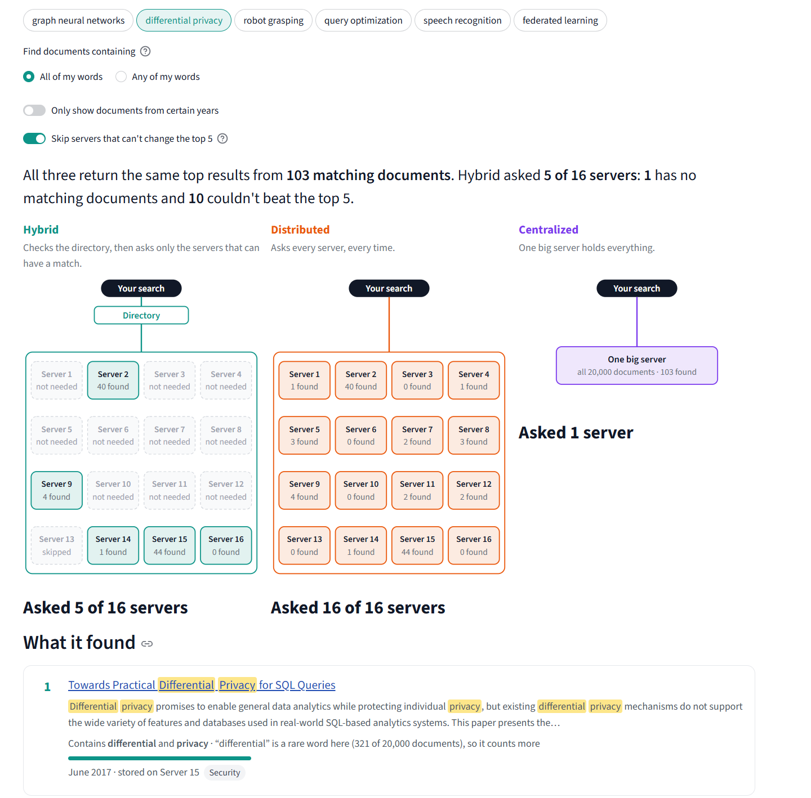

# Hybrid Indexing for Distributed Search

[](https://github.com/PiyushaKadam07/Big-data-Hybrid-Indexing/actions/workflows/tests.yml)

A small search engine that compares three ways of searching documents spread across several servers: one central index, a fully distributed index, and a hybrid of the two. Built for CS63016 (Big Data) at Kent State University.



*Searching 20,000 real arXiv papers for "differential privacy" across 16 servers. Distributed search asks all 16. Hybrid asks 5: one server is ruled out because it doesn't have both words, and ten are skipped because nothing on them could beat the top 5. All three return the same results.*

## The idea

When a collection gets too big for one machine, you split it across servers. The question is what to do when someone searches.

- **Centralized:** keep one big index with everything. Simple, but it becomes the bottleneck.
- **Distributed:** split the documents across servers and send every search to every server. It scales, but most of those servers usually have nothing useful to say.
- **Hybrid:** split the documents across servers, and keep a small central directory that records which words (and which dates) live on which servers. A search checks the directory first and only contacts the servers that can actually have a match.

All three return the same results. What changes is how many servers each search has to contact, which on a real network is what costs time and money.

## What I found

I tested it on 20,000 real computer science papers from arXiv, split across 16 servers, with 30 searches like "graph neural networks", "differential privacy" and "robot grasping" (top 5 results). Each search was run as a plain word search and again limited to a single year. Distributed search always contacts all 16 servers. Hybrid contacted, on average:

| Placement | Word search | + skip by score | One-year search | + skip by score |
| --- | --- | --- | --- | --- |
| Random | 16.0 | 16.0 | 16.0 | 16.0 |
| By topic | 13.9 | **7.5** | 13.9 | 13.1 |
| By date | 15.8 | 15.4 | **2.4** | 2.4 |

The top 5 results were identical to centralized search for every search. The three placements:

- **Random:** papers are spread evenly by hashing their ID.
- **By topic:** each arXiv category (machine learning, vision, databases and so on) gets a home server.
- **By date:** each server holds a range of submission dates, like the volumes of an encyclopedia.

What the numbers say:

1. **Knowing where words are isn't enough on real data.** Even with papers grouped by topic, hybrid still contacted 13.9 of 16 servers, because research words cross fields. Graph neural networks show up in machine learning, vision, chemistry and robotics papers, so nearly every server holds at least one match.
2. **Knowing where the best matches are is what helps.** The directory also keeps each server's best possible score for each word. Hybrid asks the most promising server first, then skips any server that couldn't beat the 5th result it already has. With topic placement that cut it to 7.5 servers, 53% fewer than distributed, with exactly the same top 5.
3. **Date placement wins when searches are limited by date.** A search limited to one year contacted 2.4 of 16 servers, 85% fewer than distributed, because the directory knows which servers hold which years.
4. **Random placement saves nothing.** Every topic and every year ends up on every server.

The takeaway is to place data the way people search it, and to route on where the best answers are, not just on where the words are.

To reproduce these numbers, run `python benchmark.py`.

### How it scales

The app's "What happens at scale" page reruns a smaller version of the experiment on 2,000 generated documents across 2 to 16 servers. Generated text is much more regular than real abstracts (each topic uses its own small vocabulary), so routing looks better there than on real papers, but the pattern is the same: distributed grows with every server added, and the right placement keeps hybrid nearly flat.


### Matching all words or any word

How a multi-word search matches matters too. On the arXiv sample, "graph neural networks" matched about a quarter of all 20,000 papers when any one of the words was enough, because nearly every computer science paper mentions networks. Then every server has a match and hybrid can't skip anything. Requiring all of the words, as most search engines do, gives far fewer and more relevant results, and lets the directory skip any server that is missing one of the words.

## How it works

1. **Tokenizing.** Text is lowercased and split into words. Hyphenated terms like `b-tree` and `real-time` stay whole, punctuation is dropped, and filler words like "the" are ignored.
2. **Inverted index on each server.** Each server keeps a map from every word to the documents that contain it, the same basic structure Lucene and Elasticsearch use.
3. **Central directory (metadata index).** Records which servers hold each word, plus collection-wide word counts. It doesn't store any documents, so it stays small.
4. **Routing.** A hybrid search asks the directory which servers hold all of the query words (or any of them, if you choose), and documents from the requested dates if there's a date limit. It then asks the most promising of those servers first and skips any that couldn't beat the results it already has. The rest are contacted in parallel.
5. **Ranking with BM25.** Documents that contain more of the query words, and rarer words, rank higher. The directory supplies the collection-wide statistics so every server scores the same way, which is why all three approaches produce identical rankings.

Placement options:

- **By topic:** each topic gets a home server. The biggest topics are placed first, each on the server holding the fewest documents, so servers stay balanced even when topic sizes differ a lot.
- **By date (range placement):** the date boundaries are chosen from the data so every server holds about the same number of documents.
- **By hash:** documents are spread evenly by hashing their ID.

## Running it

You'll need Python 3.10 or newer.

```bash
git clone https://github.com/PiyushaKadam07/Big-data-Hybrid-Indexing.git
cd Big-data-Hybrid-Indexing
pip install -r requirements.txt
streamlit run app.py
```

### The arXiv papers

The repo includes a sample of 20,000 computer science papers from arXiv (`data/arxiv_sample.jsonl`, about 30 MB), so the app searches real papers out of the box. Each result links to the paper on arxiv.org. Choose **20 sample sentences** in the sidebar for a small example you can follow by eye.

Each paper's main arXiv category (machine learning, computer vision, databases and so on) is used as its topic for topic placement, and its submission month, read from the arXiv ID, is used for date placement and the year filter. Indexing 20,000 papers takes about 6 seconds and around 200 MB of memory.

To make a different sample, download the [arXiv dataset from Kaggle](https://www.kaggle.com/datasets/Cornell-University/arxiv) (you only need `arxiv-metadata-oai-snapshot.json`; it's several GB, so a Kaggle notebook is the easiest place to run this) and run:

```bash
python load_arxiv.py path/to/arxiv-metadata-oai-snapshot.json --size 20000
```

arXiv's metadata is released under CC0, so the sample can be shared freely.

The app opens in your browser and has four pages:

- **Try a search:** type a query, choose whether results need all of your words or any of them, optionally limit it to certain years, and see which servers each approach contacted, with the matching words highlighted in the results.
- **How it works:** a plain-language walkthrough.
- **What happens at scale:** reruns the experiment above on 500 to 5,000 documents.
- **Look inside the servers:** what each server holds, and which servers have a given word.

To run the tests (they also run automatically on GitHub after every push):

```bash
pytest
```

## Project layout

```
hybrid_index.py        the search engine: servers, directory, routing, BM25
app.py                 the Streamlit app
dataset_generator.py   generates synthetic documents for the scale experiment
load_arxiv.py          makes a sample of computer science papers from the arXiv dataset
benchmark.py           measures servers contacted on the arXiv sample
tests/                 tests for tokenizing, ranking, routing and identical results
assets/                screenshots used in this README
```

## Limitations

- Everything runs in one Python process. The "servers" are objects, not separate machines, so the app measures servers contacted rather than real network time.
- The scale experiment uses generated documents with example dates. Running it on the arXiv sample is the next step.
- The 20 sample sentences are given example dates so every placement works on them.
- Topic placement keeps a whole topic on one server. On arXiv, machine learning and computer vision are each about a fifth of all computer science papers, so with 8 or more servers those two servers end up larger than the rest. A real system would split very large topics across several servers.
- Topic placement assumes each document has a topic label. Real systems would need to cluster documents or route by category.

## Author

Piyusha Kadam
